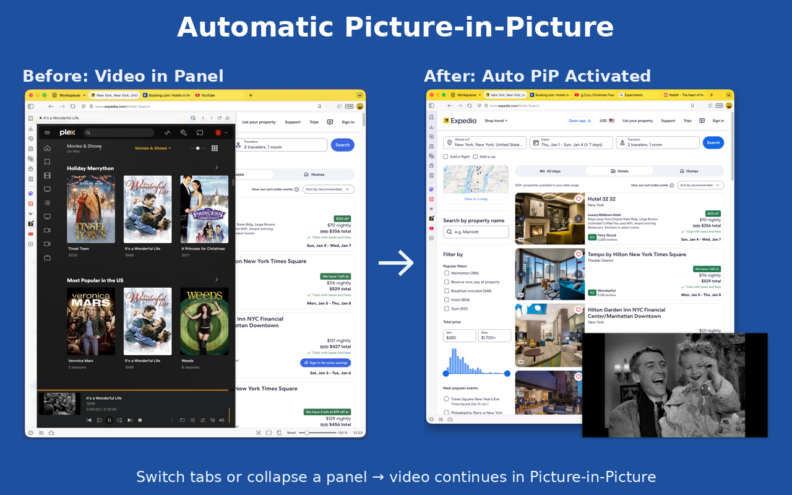

# Better Auto PiP

Automatically enable Picture-in-Picture for videos when switching tabs or collapsing Vivaldi panels. Works with YouTube, Netflix, Plex, Twitch, and more.

## Features

- **Tab Switching**: Automatically enters PiP when you switch away from a video tab
- **Vivaldi Panel Collapse**: Enters PiP when you collapse a Vivaldi panel containing a video
- **Per-Site Controls**: Enable/disable features for specific websites
- **Custom Sites**: Add any other website yourself (Options → Custom Sites); your browser asks you to allow access to each site
- **Customizable**: Adjust timing, delays, and behavior to your preferences

## Supported Sites

- YouTube
- Netflix
- Plex
- Twitch
- Hulu
- Vimeo
- Dailymotion
- Crunchyroll
- ESPN
- Microsoft Teams
- Google Meet

Not on the list? Open the extension's **Options**, enter the site under **Custom Sites** and click **Add site**. Your browser will ask you to allow access to that site. If the video plays in an embedded player from a different website, add that website as well.

Prefer not to add sites one by one? Turn on **Allow on all sites** in Options. Your browser asks once for access to all websites, and you can turn it off at any time. With it on, automatic Picture-in-Picture works on every site, including videos inside embedded players (an iframe from another website).

## Installation

### From Chrome Web Store
[Better Auto PiP on Chrome Web Store](https://chromewebstore.google.com/detail/better-auto-pip/fhlnhgbimopgpeemkifjgeepoinamikl)

### Manual Installation (Development)
1. Clone or download this repository
2. Open Chrome/Vivaldi and navigate to `chrome://extensions`
3. Enable "Developer mode"
4. Click "Load unpacked"
5. Select the `src` folder

## Usage

1. Install the extension
2. Navigate to a supported video site
3. Start playing a video
4. Switch tabs or collapse the panel (Vivaldi only)
5. Video automatically enters Picture-in-Picture mode

## Settings

Access settings by clicking the extension icon or right-clicking and selecting "Options":

- Enable/disable the extension globally
- Configure panel collapse detection (Vivaldi only)
- Adjust tab switch delay
- Per-site enable/disable controls
- Add or remove custom sites (each site is allowed separately; removing a site also revokes its access)
- Allow on all sites (optional, off by default)

## Vivaldi Panel Auto-PiP (Keyboard Shortcut Setup)

Because of a Chromium restriction, web panels cannot enter Picture-in-Picture automatically on collapse without a user gesture. The extension provides a keyboard command that bypasses this when paired with Vivaldi's panel toggle shortcut:

1. Open `chrome://extensions/shortcuts` and set a shortcut (default `Ctrl+Shift+P` / `Cmd+Shift+P`) for **Better Auto PiP → Trigger Picture-in-Picture**.
2. In Vivaldi, open **Settings → Keyboard → View** and bind the **same** shortcut to **Toggle Web Panel**.
3. Pressing the shortcut now collapses the panel *and* triggers PiP in a single keypress.

## Notes on Chrome's Built-in Auto-PiP

Chrome 134+ has a built-in auto-PiP feature driven by the Media Session API. When enabled, Chrome may enter PiP on tab switches *before* this extension's code runs. Consequences:

- The **Tab Switch Delay** setting only applies when the extension drives PiP. If Chrome's native auto-PiP fires first, PiP appears instantly regardless of your delay.
- If you've disabled the extension for a site but PiP still activates, it's Chrome's native behavior. The extension will detect this and **auto-exit PiP** for sites where it's been disabled.
- To disable Chrome's built-in auto-PiP entirely, visit `chrome://flags` and toggle off **Auto picture in picture for video playback**.

## License

MIT License - See LICENSE file for details

## Author

**SeanHarsh**
- GitHub: https://github.com/seanharsh/Better-Auto-PiP

## Privacy

This extension does not collect, store, or transmit any user data. All settings are stored locally on your device.